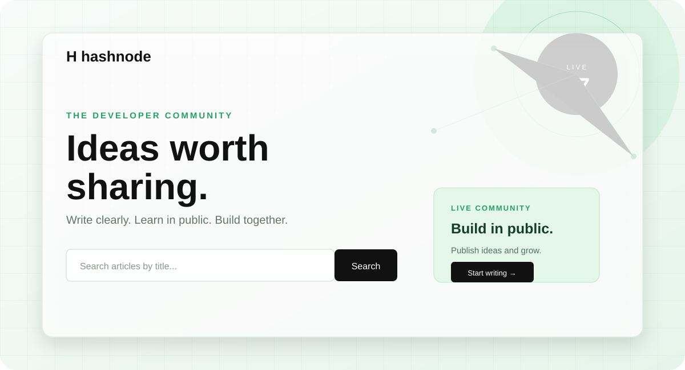

# Hashnode Blog Platform



A polished, developer-first blogging platform built with the MERN stack. The
project combines a modern publishing workflow with a responsive black-and-white
interface, live animated backgrounds, offline demo data, and community features.

## Live project

- **GitHub:** [omsatote/hashnode-blog-platform](https://github.com/omsatote/hashnode-blog-platform)
- **Local frontend:** `http://localhost:5175`
- **Local API:** `http://localhost:4000`

## Highlights

- JWT registration, login, logout, and persisted sessions
- Public blog feed with search, topic filters, sorting, and pagination
- Markdown editor with preview and code syntax highlighting
- Save drafts, publish articles, edit posts, and delete owned posts
- Tags, categories, author profiles, and personal dashboard
- Likes, comments, follow/unfollow, bookmarks, and reading-time estimates
- Optional Cloudinary cover-image uploads with URL fallback
- Responsive layout for desktop, tablet, and mobile screens
- Animated buttons, cards, page transitions, live hero elements, and Vanta.js
  network particles
- Additional moving background layers: glow orbs, perspective grid, and rings
- Offline/demo fallback content so the frontend remains useful without MongoDB
- Reduced-motion support for visitors who prefer fewer animations

## Technology

### Frontend

- React 18
- Vite
- React Router
- Axios
- React Markdown and remark-gfm
- React Syntax Highlighter
- Three.js and Vanta.js

### Backend

- Node.js and Express
- MongoDB with Mongoose
- JWT and bcryptjs authentication
- Cloudinary image upload integration
- Slugify for readable article URLs

### Infrastructure

- Docker Compose for MongoDB and Redis
- Separate client and server packages
- Environment-based configuration

## Project structure

```text
hashnode/
├── client/
│   ├── src/
│   │   ├── main.jsx       # Routes, UI, demo data, auth, editor, feed
│   │   └── styles.css     # Responsive theme and animations
│   └── package.json
├── server/
│   ├── src/
│   │   ├── models.js      # User, post, tag, and comment schemas
│   │   ├── seed.js        # Demo database seed
│   │   └── server.js      # Express API
│   └── package.json
├── docs/preview.svg
├── docker-compose.yml
└── package.json
```

## Run locally

### Requirements

- Node.js 18 or newer
- npm
- Docker Desktop (optional, for MongoDB and Redis)

### 1. Install dependencies

From the project root:

```bash
npm install
npm install --prefix client
npm install --prefix server
```

### 2. Configure the API

Copy `server/.env.example` to `server/.env` and set a secure JWT secret:

```env
PORT=4000
MONGO_URI=mongodb://localhost:27017/hashnode
JWT_SECRET=replace-with-a-long-random-secret
CLIENT_URL=http://localhost:5175
```

For frontend API configuration, copy `client/.env.example` to `client/.env`
when the API is not running on the default URL:

```env
VITE_API_URL=http://localhost:4000/api
```

Never commit `.env` files or real credentials.

### 3. Start MongoDB and Redis

```bash
docker compose up -d
```

### 4. Seed demo data

```bash
npm run seed --prefix server
```

### 5. Start the application

Run both client and API together:

```bash
npm run dev
```

Or start them separately:

```bash
npm run dev --prefix server
npm run dev --prefix client
```

The Vite client normally uses port `5173`. If that port is occupied, Vite will
select another available port.

## Demo mode

The client includes local fallback content and local persistence for development
without a running database.

```text
Email:    demo@hashnode.local
Password: hashnode123
```

Local demo data is stored in browser local storage. A real MongoDB connection
enables the full API-backed workflow.

## Image uploads

The editor accepts a cover-image URL without additional configuration. To
enable Cloudinary uploads, add these values to `server/.env`:

```env
CLOUDINARY_CLOUD_NAME=
CLOUDINARY_API_KEY=
CLOUDINARY_API_SECRET=
```

## Production build

Build the client:

```bash
npm run build
```

Start the API:

```bash
npm start
```

For Vercel, deploy the `client` directory as the frontend and configure
`VITE_API_URL` to point to a deployed API. MongoDB should be hosted using a
managed provider such as MongoDB Atlas, and production secrets must be set in
the hosting provider's environment settings.

## API areas

The Express API provides endpoints for:

- Authentication and user profiles
- Public and authenticated post CRUD
- Draft and publish workflows
- Search, tags, and pagination
- Likes, comments, follows, and bookmarks
- Cloudinary uploads

## Development notes

- The frontend deliberately falls back to demo content when the API is
  unavailable, which keeps the UI easy to preview.
- The Vanta effect is cleaned up when the app unmounts.
- All animated background layers use `pointer-events: none`, so they never
  interfere with navigation or editor controls.
- `prefers-reduced-motion` disables decorative motion for accessibility.

## License

This project is provided for learning and demonstration purposes.
